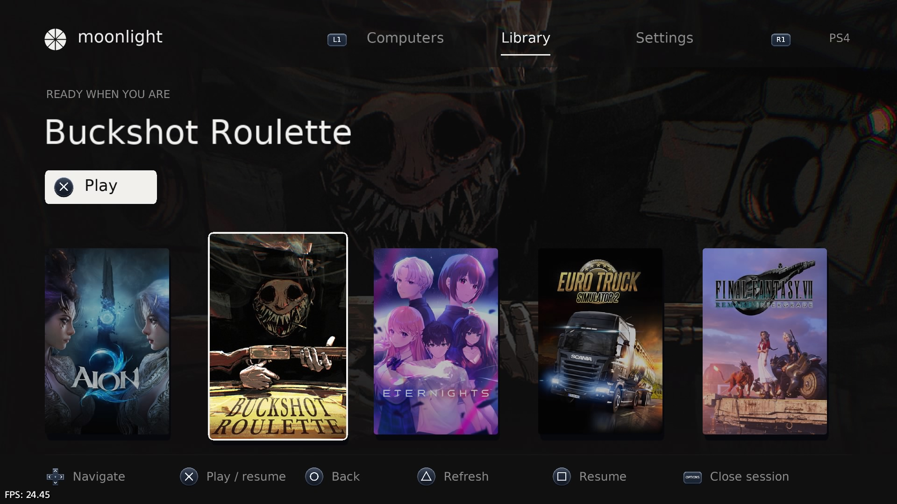
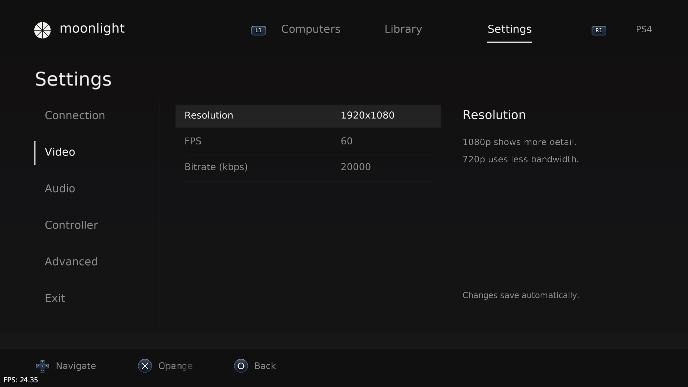

# Moonlight PS4

### 1.4.0

Your PC games, on your PS4. Built around a DualShock 4 and Sunshine.

**[Download PKG](https://github.com/Akryst/Moonlight-ps4/releases/download/v1.4.0/Moonlight-PS4-01.40.pkg)** · **[Release notes and checksums](https://github.com/Akryst/Moonlight-ps4/releases/tag/v1.4.0)**

Actual PS4 capture from the build leading into 1.4.0. Game artwork belongs to its respective owners.

I wanted this to feel like an app you'd actually open on a console. Pick your PC,
find a game, play. So the library got a proper redesign, the settings finally have
some breathing room, and the controller prompts are actual images.

**1.4.0** brings the interface work and the controller/network updates together.
There's still work to do, but this is a much nicer place to play from.

## what's new

The library has portrait covers, game backgrounds, smoother focus movement and
a splash transition when you open the app. Covers and the game list are cached
on disk. Refreshing them happens in the background, so the menu stays usable.
Five themes are included: Midnight, Mono, Blue Wave, Daylight and Cinema.
Reduced motion is available in Settings.

Up to **four logged-in DualShock 4s** get their own controller slots and player
colors. Rumble reaches the motors, and host lightbar changes go back to the
matching physical pad. Input uses a 4 ms polling interval, targeting 250 Hz.
The L1 + R1 + Options shortcut keeps its short Guide pulse, including when you
hold the buttons down.

The touchpad can work as a mouse: move, drag, click, two-finger right click and
high-resolution scrolling. Games can request gyro and accelerometer reports.
You can turn motion off globally or just for the game selected in Library.
Deadzone and Cross/Circle swap settings are still there too.

Starting a game now shows its name, the current launch step and elapsed time.
Circle cancels. If a session gets stuck, the launch flow can clean it up and retry.
Errors show the PC's answer, with X to retry and Triangle to refresh the app list.
A dropped stream gets automatic resume attempts instead of immediately dumping
you back into the library.

**5.1 audio** is optional under Settings -> Audio. It uses the PS4's 8-channel
HDMI output and falls back to a stereo downmix if that port can't be opened.
Stereo stays the default. Settings -> Exit -> Exit Moonlight gives the app a
title-side exit to the dashboard. The development-version startup toast is gone.

And yeah, **Playnite** is included if it's installed on your PC. The optional
Windows companion handles it alongside Steam. Synchronization runs once when
Moonlight opens and connects. Returning from a game or refreshing the library
doesn't start another scan. The old five-minute PowerShell interruptions stay gone.

## settings, finally

Connection, Video, Audio, Controller, Advanced and Exit have their own sections.
Changes save automatically. This is another capture from the PS4, not a desktop
mockup. Both screenshots were taken on the 01.36 test build before the release
version and startup notification were changed.

## install

The tested console setup is an original PS4 on **firmware 9.00 with GoldHEN**,
a DualShock 4 and a wired PC running [Sunshine](https://github.com/LizardByte/Sunshine).
Other console and firmware combinations haven't been verified.

1. Download `Moonlight-PS4-01.40.pkg` and `SHA256SUMS` from the
   [1.4.0 release](https://github.com/Akryst/Moonlight-ps4/releases/tag/v1.4.0).
2. Install the PKG through GoldHEN's Package Installer. The title ID is still
   `MLNT00001`, so it updates the existing app and keeps `/data/moonlight`.
3. Open **Computers** and connect to your PC. Use Triangle to search or enter
   the PC's IPv4 address in Settings if discovery doesn't find it.
4. Enter the displayed PIN in Sunshine, then open **Library** and pick a game.

A good starting point is **1080p, 60 FPS, 20,000 kbps, hardware decoding and
Balanced mode**. Use Desktop for external launchers such as TruckersMP.

For Steam library synchronization and installed Playnite detection, grab
`Moonlight-PS4-Steam-Companion-01.40.zip` from the same release and follow
[the companion setup](docs/STEAM.md). Existing companion installations need the
updated scripts for Playnite support. Sunshine streaming also works without it.

## controls

| Input | Action |
| --- | --- |
| D-pad | Navigate |
| X / Circle | Confirm / back |
| L1 / R1 | Switch tabs |
| Triangle | Search for PCs / refresh games |
| Square in Library | Select the running game for resume |
| Options in Library | Ask to close the active host session |
| L1 + R1 + Options while streaming | Send a short Guide pulse to the PC |
| Hold L3 + R3 for 2.5 seconds | Open the stream menu in BGRA mode |
| Circle during launch | Cancel the launch |
| X / Triangle after a launch error | Retry / refresh the app list |

The physical PS button belongs to the console menu. Use the Guide shortcut for
Steam Big Picture. The stream menu has touchpad, performance overlay, bitrate
and quit controls. Inputs return to neutral before going back to the game.

## what still needs testing

This is still an **experimental homebrew client**. The UI has been captured on
real hardware, and the package build and automated checks pass. That doesn't
turn every new feature into a hardware-tested one.

Four physical pads together, gyro calibration, HDMI surround channel routing,
network-drop recovery and both exit paths still need broader console testing.
The fault handlers record a marker and exit; they don't repair the underlying
fault or guarantee that closing through the system menu avoids a crash dialog.

Locked 60 FPS isn't guaranteed. Older measurements are in
[the presentation notes](docs/PRESENTATION_01_34.md) and
[the ETS2 analysis](docs/ETS2_01_32.md); they're not benchmarks for 1.4.0.
Native YCbCr presentation remains experimental and doesn't support the stream
menu overlay. Use the normal BGRA path for that menu.

## building and reporting issues

Build instructions are in [docs/BUILD.md](docs/BUILD.md). The imported changes,
adaptations and validation details are in [the integration notes](docs/FORK_INTEGRATION.md).

For a bug report, include your client version, PS4 model/firmware, Sunshine
version, connection type, resolution, bitrate and the steps that trigger it.
Performance overlay and file logging help with stutters. Remove personal data
from logs and keep pairing keys and certificates private.

## credits

Maintained by [Akryst](https://github.com/Akryst).

Based on [JaimeJimenezG/Moonlight-ps4](https://github.com/JaimeJimenezG/Moonlight-ps4).
Controller, recovery, HTTP, audio and presentation work was adapted from
[raferrazz/Moonlight-ps4](https://github.com/raferrazz/Moonlight-ps4).

Built with [moonlight-common-c](https://github.com/moonlight-stream/moonlight-common-c),
[OpenOrbis](https://github.com/OpenOrbis/OpenOrbis-PS4-Toolchain), Sunshine,
FFmpeg, Opus and mbedTLS. Dependency pins: [third_party/DEPS](third_party/DEPS).
Font notices: [vendor/FONT-LICENSE.txt](vendor/FONT-LICENSE.txt).
UI asset notes: [design/ASSETS_01_31.md](design/ASSETS_01_31.md) and
[controller prompts](preview/assets/README.md).

This is an unofficial client, independent of the official Moonlight project.
Existing upstream licenses and notices apply. Product names and game artwork
belong to their respective owners.
